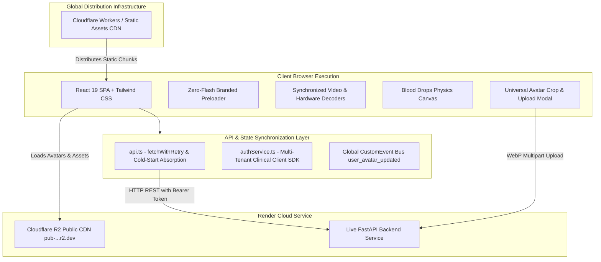

# BloodMatch Frontend Architecture & Operational Brain (`brain.md`)

> [!CAUTION]
> **CRITICAL SECURITY DIRECTIVE**:
> **NEVER COMMIT `.env` FILES, API KEYS, OR PRODUCTION SECRETS TO GITHUB.**
> All frontend configuration must be managed through local `.env` files (which are strictly excluded via `.gitignore`) or Cloudflare Pages/Workers **Build environment variables**.

---

## 1. Architectural Topology & Systems Overview



---

## 2. Environment Variables Reference (Local `.env` & Cloudflare Builds)

In Vite applications, all `VITE_*` variables are statically compiled into production JavaScript chunks during `npm run build`.

| Environment Variable | Production Value | Purpose & Usage in Code |
| :--- | :--- | :--- |
| **`VITE_BACKEND_URL`** | `https://blood-match-backend.onrender.com` | Primary API base URL. Read dynamically by `API_BASE_URL` in `src/services/api.ts`. |
| **`VITE_API_URL`** | `https://blood-match-backend.onrender.com` | Inter-compatible alias for `VITE_BACKEND_URL`. |
| **`VITE_SUPABASE_URL`** | `https://uiwnzdyvriuslqajwwgf.supabase.co` | Supabase project API gateway endpoint for client-side queries. |
| **`VITE_SUPABASE_ANON_KEY`** | `eyJhbGciOi...` | Public anonymous access token for Supabase client authorization. |
| **`VITE_R2_PUBLIC_URL`** | `https://pub-5a4ed1cf142043998d5af2e9b797e868.r2.dev` | Public CDN URL for loading clinician profile pictures, avatars, and clinical documents. |
| **`VITE_GOOGLE_APP_SCRIPT_URL`**| `https://script.google.com/macros/s/<ID>/exec` | Direct client-side submission endpoint fallback for Google Apps Script notifications. |

---

## 3. Core Frontend Subsystems

### A. Zero Hardcoded URLs Directive
* No API URLs or endpoints are hardcoded in application components.
* `src/services/api.ts` extracts `API_BASE_URL` dynamically from:
  `((import.meta as any).env?.VITE_BACKEND_URL || (import.meta as any).env?.VITE_API_URL || '').replace(/\/+$/, '')`
* If no environment variable is present, it defaults to a relative path `''` ensuring compatibility behind reverse proxies.

### B. Cold-Start Absorption & Resilient Network Retries (`src/services/api.ts`)
* `fetchWithRetry` intercepts transient network disconnections (`TypeError: Failed to fetch`) and free-tier container sleep (502, 503, 504 errors on Render cold starts).
* Executes exponential backoff (1200ms base delay, up to 3 retries, with an 18-second timeout window) to absorb container spin-up without displaying error alerts to the user.

### C. Zero-Flash Preloader & Video Synchronization
* **`index.html` Pre-Mount Shield**: An inline CSS styled clinical brand shield rendered synchronously inside `<div id="root">` prevents unstyled white flashes while scripts download.
* **Coordinated Preloader Events**: `BloodPreloader.tsx` dispatches `bloodmatch_preloader_opening` and `bloodmatch_preloader_complete` upon reaching 100% calibration.
* **Smooth Video Crossfade**: `Login.tsx`, `Signup.tsx`, and `AmbientBackgroundVideo.tsx` display a static `/login_poster.jpg` layer underneath `<video>` at `opacity-0`. Video playback is suspended until the preloader finishes, preventing GPU contention, and transitions into view via a 700ms opacity crossfade.

### D. Universal Avatar Upload & Zero-Refresh Synchronization (`AvatarUploadModal.tsx`)
* Supports drag-and-drop file upload for JPG, PNG, and WebP formats.
* Features interactive cropping with zoom slider (1x to 3x), 90-degree rotation, and canvas repositioning.
* Dispatches `window.dispatchEvent(new CustomEvent('user_avatar_updated', { detail: { photoUrl } }))` upon successful upload, updating the top navbar, sidebar profile card, consultation badges, and user dropdown menu without a page reload.

---

## 4. Local Development & Build Commands

```bash
# 1. Install dependencies
npm install

# 2. Run local development server (Vite HMR on :5173)
npm run dev

# 3. Compile production bundle (Type check + Vite build)
npm run build

# 4. Preview compiled production bundle locally
npm run preview

# 5. Deploy to Cloudflare Workers (Static Assets)
npx wrangler deploy
```
